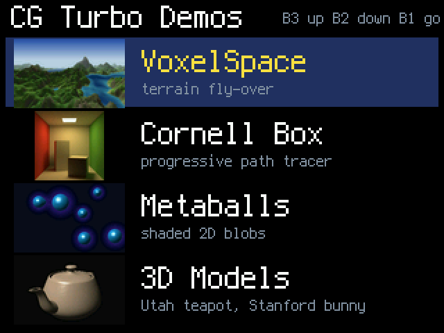
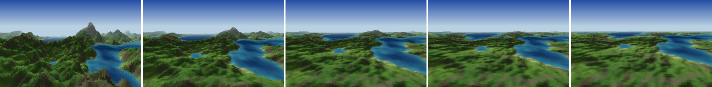
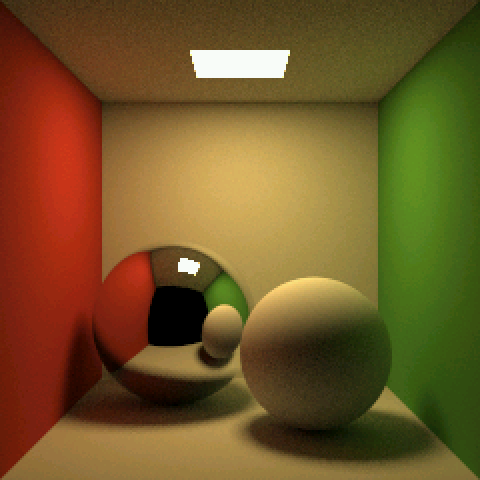
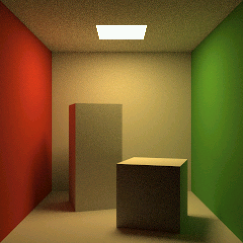
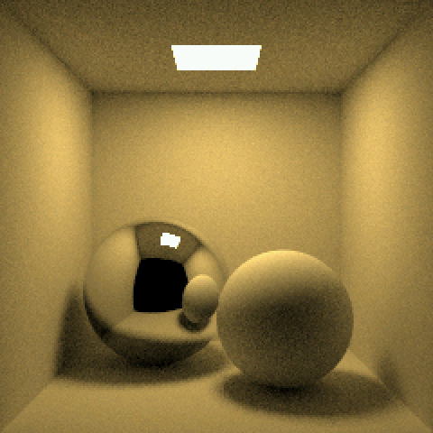
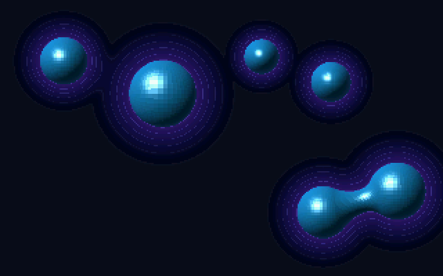
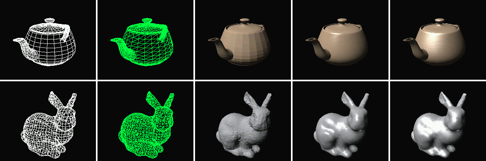
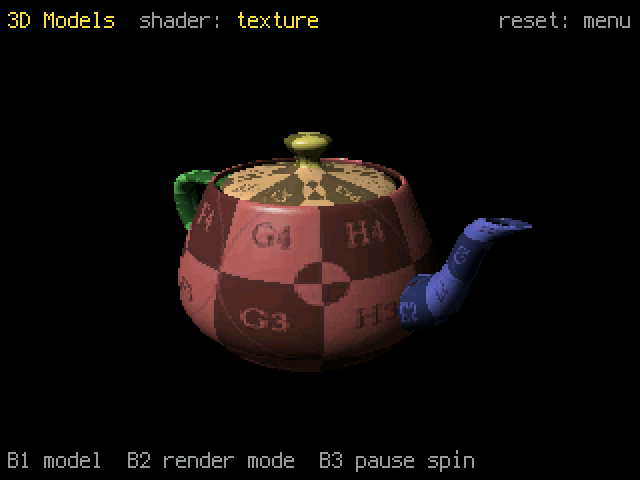

# CG Turbo Demos

Computer graphics demos in the spirit of early SIGGRAPH, running on an
[Adafruit Fruit Jam](https://www.adafruit.com/search?q=fruit+jam) (RP2350) in
CircuitPython, with the hot loops in
[CircuitPython Turbo](https://learn.adafruit.com/circuitpython-turbo): Viper
code compiled ahead of time with `mpy-cross`, plus `asm_thumb` inner loops.
Output is 320x240 RGB565, pixel-doubled to 640x480 HDMI by `picodvi`.


## install on a Fruit Jam

1. Install [CircuitPython](https://circuitpython.org/board/adafruit_fruit_jam/)
   10.3.1 or later on the Fruit Jam (tested on 10.3.1 and 11.0.0-alpha.1). The demos'
   compiled modules are `.mpy` version 6.3: if a future CircuitPython moves
   to a newer `.mpy` version, they stop loading (`ValueError: incompatible
   .mpy file`) until rebuilt (see "build from source").
2. Get the files: the Learn guide's **Download Project Bundle** button zips
   everything, libraries included (use the folder for your CircuitPython
   version). Or copy the contents of `CG_Turbo_Demos_Code/` from this
   folder and install the one library the demos need,
   `adafruit_display_text` (`circup install adafruit_display_text`, or from
   the [library bundle](https://circuitpython.org/libraries)).
3. Save the `code.py` already on your CIRCUITPY drive if you want to keep
   it, then copy the files to CIRCUITPY (about 2 MB), merging `lib` folders.
4. Plug in an HDMI display. The board restarts into the menu.

## demos

The board boots into a menu of the demos: button 3 moves up, button 2 down,
button 1 starts the one highlighted. Each demo shows its buttons in the
border around its image. Press reset to come back to the menu.



**VoxelSpace** (`CG_Turbo_Demos_Code/voxel_demo.py`): a Comanche-style voxel terrain
fly-over after [s-macke/VoxelSpace](https://github.com/s-macke/VoxelSpace),
on generated terrain, at a locked 30 fps (320x200, letterboxed).

| button | does |
| --- | --- |
| 1 | color map -> height map -> shaded height map |
| 2 | terrain height: full -> 1/2 -> 1/4 -> 1/8 -> flat |
| 3 | fog on / off |




**Cornell box** (`CG_Turbo_Demos_Code/cornell_demo.py`): a progressive path tracer, 240x240,
one sample per pixel per pass (0.73 s), refining on screen from noise to a
clean image in a minute or two. The asm kernel uses the RP2350's FPU and is
bit-identical to the numpy reference in `tools/cornell_ref.py`.

| button | does |
| --- | --- |
| 1 | side walls white / back to red and green (starts over) |
| 2 | start over from zero samples |
| 3 | the original's two boxes / back to the two spheres (starts over) |





**Metaballs** (`CG_Turbo_Demos_Code/metaballs_demo.py`): six 2D metaballs gliding on
Lissajous paths, shaded as glossy 3D blobs that merge, over a glowing
contoured field. 30 fps at 320x200 with six balls; the asm frame kernel is
bit-identical to the viper reference.

| button | does |
| --- | --- |
| 1 | next hue (six); double-click: glow off / on |
| 2 | one ball fewer (down to 1) |
| 3 | one ball more (up to 10) |




**3D models** (`CG_Turbo_Demos_Code/meshes_demo.py`): the Utah teapot (3,926 triangles) and
the Stanford bunny (3,851), spinning slowly and filling the window, at 30 fps
in every mode. The
transform runs on the FPU, then back-face culling, a bucket sort back to front
and an integer scanline fill, all in asm and bit-identical to the references.
Phong and Blinn light every pixel from its interpolated normal. The teapot is
a cool glazed clay and the bunny light gray (`tools/make_mesh_luts.py`).
The teapot also wears a 512x512 texture: a UV test grid on an injective
layout (body around the bottom half; lid, handle and spout in the top half),
each part tinted as in the Utah teapot page's layout figure, Phong lit, with
texture coordinates and normals interpolated per pixel.

| button | does |
| --- | --- |
| 1 | teapot / bunny |
| 2 | quad wireframe (white, the start) -> triangle wireframe (green) -> Lambert (flat) -> Phong -> Blinn -> texture (teapot only) |
| 3 | pause / resume the spin |




The teapot is Martin Newell's 1975 Bezier patch data (via three.js); the
bunny is from the
[Stanford 3D Scanning Repository](https://graphics.stanford.edu/data/3Dscanrep/).
`tools/make_meshes.py` downloads both and rebuilds `CG_Turbo_Demos_Code/teapot.bin` and
`CG_Turbo_Demos_Code/bunny.bin`. The texture is the UV test grid from the University of
Utah's [teapot page](https://graphics.cs.utah.edu/teapot/), whose injective
layout this one follows; `tools/make_teapot_texture.py grid.png` rebuilds
`CG_Turbo_Demos_Code/teapot_texture.bin` from it.

To skip the menu while developing, set `DEMO` in `CG_Turbo_Demos_Code/code.py` to a demo's
module (`"voxel_demo"`, `"cornell_demo"`, `"metaballs_demo"` or
`"meshes_demo"`). The menu's thumbnails come from
`python3 tools/make_menu_thumbs.py`.

Coming: USB gamepad flying, and more Cornell box scenes. See
[NOTES.md](NOTES.md) for the plan, every measurement, and what was learned
about making Turbo code fast on this board.

## hardware and firmware

- Adafruit Fruit Jam and an HDMI display.
- Stock CircuitPython 10.3.1 or later (Turbo `.mpy` loading is built in on
  RP2xxx). Developed on `11.0.0-alpha.1-126-gea91926f34`; the same build also
  runs on 10.3.1.

## build from source

Everything the board runs is already built in `CG_Turbo_Demos_Code/`; this is
for changing it.

- Adafruit's `mpy-cross` that emits `.mpy` version 6.3 (the one for your
  firmware is a safe choice: `mpy-cross --version` says which `.mpy`
  version it writes), saved as `tools/mpy-cross`: builds are at
  `https://adafruit-circuit-python.s3.amazonaws.com/bin/mpy-cross/macos/mpy-cross-macos-<version>-arm64`
  (other platforms in the neighboring folders). A native `.mpy` loads when
  its `.mpy` version and sub-version, architecture (`armv7emsp`) and
  small-int width match the firmware's, not only on the exact firmware it
  was built for.
- Python 3 with NumPy and Pillow for the tools.

```sh
python3 tools/build.py --deploy        # compile turbo_source/ into CG_Turbo_Demos_Code/, copy that to CIRCUITPY
python3 tools/serial_log.py --restart  # restart code.py and watch the console (frame times)
```

The first deploy saves the board's existing `code.py` to `backup/`. Deploy
doesn't install `adafruit_display_text`: put it in CIRCUITPY's `lib` as in
"install on a Fruit Jam". `code.py` starts the menu (see "demos" for
skipping it).

## layout

- `CG_Turbo_Demos_Code/`: what goes on the board, and what the Project
  Bundle zips. The demos are plain Python that runs from source (setup,
  camera, buttons); next to them, their data (`*.bin`, the menu's `*.bmp`)
  and the compiled Turbo modules (`*.mpy`), committed so the bundle needs
  no build. Everything in it except the `.mpy` files and `cornell_scene.py`
  is edited by hand; those are rebuilt as below.
- `turbo_source/`: the Turbo modules' source, compiled to `.mpy` by
  `tools/build.py`: Viper reference kernels and frame drivers, and the asm
  versions (`*_asm.py`, `mesh_draw.py`) that the `tools/gen_*.py` generators
  write.
- `tools/`: the build and deploy (`build.py`), asset generators
  (`make_*.py`, NumPy and Pillow), asm generators (`gen_*.py`), desktop
  reference renderers (`voxel_host.py`, `cornell_ref.py`,
  `metaballs_host.py`, `mesh_ref.py`) and board runners; `tools/host/` has
  the stand-ins that let the Viper kernels run under CPython;
  `tools/bench/` the framebuffer benchmark from the start of the project.
- `tools/asm_to_viper.py` is from Adafruit's
  [Motion Tracking Eyeballs](https://github.com/adafruit/Adafruit_Learning_System_Guides/tree/main/CircuitPython_Turbo/Motion_Tracking_Eyeballs)
  guide (MIT, Liz Clark): it lets stock firmware load `asm_thumb` code.
- `docs/`: the README's screenshots and the terrain previews.
- [NOTES.md](NOTES.md): the development log: the plan, every measurement,
  and what was learned about making Turbo code fast on this board.

The desktop renderers run the same Viper reference kernels as the board
(with the stand-ins in `tools/host/`), and board frames from the asm kernels
are checked bit for bit against them. `turbo_source/`, `tools/` and its
subfolders carry `.circuitpython.skip`: they're Viper, asm or desktop
Python, not CircuitPython for pylint.

This code was formerly at https://github.com/adafruit/cg-turbo-demos - this
has now been archived. If you are looking to make changes/additions, please
use the GitHub Issues and Pull Request mechanisms.

## credits

Code:

- `tools/asm_to_viper.py` is from Adafruit's
  [Motion Tracking Eyeballs](https://github.com/adafruit/Adafruit_Learning_System_Guides/tree/main/CircuitPython_Turbo/Motion_Tracking_Eyeballs)
  guide by [Liz Clark](https://github.com/BlitzCityDIY) (MIT).
- The Utah teapot's Bezier patch data comes from [three.js](https://threejs.org/)'s
  [TeapotGeometry.js](https://github.com/mrdoob/three.js/blob/r160/examples/jsm/geometries/TeapotGeometry.js)
  (MIT), downloaded by `tools/make_meshes.py`.

Data and images:

- [Utah teapot](https://en.wikipedia.org/wiki/Utah_teapot):
  [Martin Newell](https://en.wikipedia.org/wiki/Martin_Newell_(computer_scientist))'s
  1975 patches. The texture is the UV test grid from the University of
  Utah's [teapot page](https://graphics.cs.utah.edu/teapot/) by
  [Cem Yuksel](https://www.cemyuksel.com/), and the injective layout and its
  part colors follow that page.
- [Stanford bunny](https://en.wikipedia.org/wiki/Stanford_bunny): the
  [Stanford 3D Scanning Repository](https://graphics.stanford.edu/data/3Dscanrep/),
  downloaded by `tools/make_meshes.py`.
- The VoxelSpace terrain is generated by `tools/make_terrain.py`; the
  Cornell box scene is modeled in `tools/cornell_scene.py`.

Research and reference:

- [s-macke/VoxelSpace](https://github.com/s-macke/VoxelSpace) by
  [Sebastian Macke](https://github.com/s-macke): the voxel terrain algorithm
  of NovaLogic's [Comanche](https://en.wikipedia.org/wiki/Comanche_(video_game_series))
  (1992), explained.
- The [Cornell box](https://en.wikipedia.org/wiki/Cornell_box), from Cornell
  University's Program of Computer Graphics: the scene and reference image
  the path tracer was compared against. Goral, Torrance, Greenberg and
  Battaile, ["Modeling the interaction of light between diffuse surfaces"](https://doi.org/10.1145/964965.808601)
  (SIGGRAPH 1984).
- Adafruit's [CircuitPython Turbo](https://learn.adafruit.com/circuitpython-turbo)
  guide, the
  [Pixeldust](https://learn.adafruit.com/pixeldust-digital-sand-for-circuitpython/code-metro-rp2350)
  guide, and [Mikey Sklar](https://github.com/mikeysklar)'s
  [turbo](https://github.com/mikeysklar/turbo) examples: how Turbo code is
  built, loaded and made fast.
- [MicroPython](https://micropython.org/)'s
  [viper code emitter](https://docs.micropython.org/en/latest/reference/speed_python.html#the-viper-code-emitter)
  docs.
- Adafruit's [Crankfruit](https://github.com/adafruit/crankfruit) (the
  Impossible-Playdate project) for the Fruit Jam's DVI output and gamepad
  input.
- The graphics papers behind the demos:
  - [Bui Tuong Phong](https://en.wikipedia.org/wiki/Bui_Tuong_Phong),
    ["Illumination for computer generated pictures"](https://doi.org/10.1145/360825.360839)
    (Communications of the ACM, 1975): Phong shading.
  - [Jim Blinn](https://www.jimblinn.com/),
    ["Models of light reflection for computer synthesized pictures"](https://doi.org/10.1145/563858.563893)
    (SIGGRAPH 1977): Blinn shading; and
    ["A generalization of algebraic surface drawing"](https://doi.org/10.1145/357306.357310)
    (ACM Transactions on Graphics, 1982): the blobby objects behind metaballs.
  - [Jim Kajiya](https://en.wikipedia.org/wiki/James_Kajiya),
    ["The rendering equation"](https://doi.org/10.1145/15922.15902)
    (SIGGRAPH 1986): path tracing.

Built with [CircuitPython](https://circuitpython.org/),
[mpy-cross](https://github.com/adafruit/circuitpython/tree/main/mpy-cross) and
[picodvi](https://docs.circuitpython.org/en/latest/shared-bindings/picodvi/),
and on the desktop [NumPy](https://numpy.org/) and
[Pillow](https://python-pillow.org/). The boot menu uses Adafruit's
[adafruit_display_text](https://github.com/adafruit/Adafruit_CircuitPython_Display_Text)
library.

## license

MIT: see [LICENSE](LICENSE). `tools/asm_to_viper.py` keeps its own MIT
notice (Liz Clark for Adafruit Industries).
